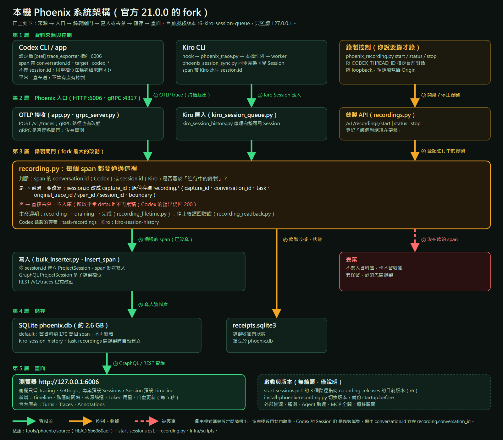

# 本機 Session 時間軸

此功能延伸專案既有的追蹤 Sessions 列表，於 Session 詳情加入 Timeline 頁籤。它不是內建 assistant 的 AgentSession，也不建立第二套 Session 資料庫。

## 系統架構圖



圖由程式碼與設定閱讀得出（2026-11-16，HEAD `5b6360aef`，目前 release r6），未逐段以封包驗證；gRPC `:4317` 是否經過錄製閘門未實測。可編輯原始檔為 [phoenix-local-architecture.html](phoenix-local-architecture.html)。

## 現行階層版本（2026-11-15）

正式入口為 <http://127.0.0.1:6006>，已部署`recording-releases/20261115-r4-hierarchy-timeline`。功能程式來源為`c1d3a38fa`，後續文件提交不代表重建前端。前端manifest SHA-256為`409c3d6ae705cc44e1fb4e187b6c758d24ee233263f23a2faf3a304aa801aa6a`。817個後端檔案與前一版r3逐檔相同，原venv、資料庫、錄製規則及migrations設定不變。

X軸為實際起訖時間，每個原始span獨立一列。Y軸縮排來自同一Session、同一trace的`parent_id`，不以時間重疊推斷父子；缺少上層及循環關係明示。Kiro只顯示已錄入的觀測區段及工具，不補造深層模型呼叫。Kiro預設收合分支，重複觀測事件預設隱藏，可切換追查。

畫面採近黑綠底、細格線、等寬字體與亮綠控制。工具為藍、模型為紫、流程為青綠、寫入為黃、觀測／其他為灰；類型色不代表結果。`UNSET`保持未知，Kiro工具的result與exit code各自保留。觀測事件不當作可靠操作耗時。

| 操作 | 方法 |
| --- | --- |
| 縮放 | 時間條區滾輪以游標位置縮放，或按＋／－；導覽區聚焦後也可按＋／－ |
| 平移 | 拖曳主時間軸，或導覽區聚焦後按左右方向鍵 |
| 框選 | Shift＋拖曳主時間軸，或在108px全程縮圖直接框選 |
| 調整範圍 | 拖曳縮圖左右把手；把手聚焦後可按左右方向鍵 |
| 回到全程 | 全程按鈕，或導覽區聚焦後按Home |
| 查看結果 | 點名稱或時間條，只顯示單筆摘要；Esc關閉摘要並保留Session側欄 |
| 深入追查 | 展開「查看原始資料」並開啟原始Trace；「用量與輪次分析」保留舊分析能力 |

自動刷新保留有效選取、範圍、分支、觀測篩選與捲動。移除聚焦節點後回到可用導覽區，不搶其他控制的焦點；移除選取節點會清除過期摘要。暫停取消未完成讀取，恢復立即載入；503失敗保留最後成功畫面及時間，恢復後繼續使用。

本次接受既有窄版限制：390px視窗下外層Layout為400px，新時間軸本身寬度與scrollWidth均319px，深層名稱及結果仍可操作。這是明示接受的10px外層溢出，沒有宣稱整頁溢出已修復。

固定功能來源的7檔47項定向測試、前端型別檢查、建置及獨立Standards／Spec複查完成。獨立發布操作判定為PASS+NOTES。正式6006的Codex35 spans／深度11、Kiro3 spans／1工具及Kiro2092 spans／1033工具，皆通過實際API瀏覽器驗收，無page errors或外部請求。動態加入／移除及進行中轉完成以公開UI fixture驗證，不能提升為生產持續寫入race的實測；未執行性能benchmark，也未宣稱全repo或雲端CI通過。

本機限定證據位於`D:/Brian/tasks/.scratch/phoenix-hierarchy-timeline/`的`results.md`及`deployment.md`；正式瀏覽器收據與截圖位於`D:/Brian/.tmp/phoenix-hierarchy-20261115/production-{codex,kiro3,kiro2092}/`。舊release與失敗證據均保留，隔離服務已停止，正式6006／4317保持loopback運行。

### r4啟動與限定回復

啟動沿用`D:/Brian/tools/phoenix/start-sessions.ps1`，停止沿用`D:/Brian/tools/phoenix/stop.ps1`。已在運行時不要重複啟動。

本次切換收據、`startup.before`及`parent-receipt.before.json`位於r4的`rollout/backend-switch/`；master安裝收據仍為r1的`rollout/receipt.json`。回復r3前先停止服務，確認6006／4317無監聽，核對目前啟動檔符合切換收據的installed_sha256，才可還原這兩個匹配備份並重新啟動。不要使用master整包restore撤除既有錄製設定，也不要把歷史`start.ps1`原版入口當成r3回復。完整限定步驟記於本機`deployment.md`。

## 精簡導覽

2026-11-12 起，本機前端側欄只顯示 `Tracing` 與 `Settings`，不提供進階入口。其他原生模組與路由保留，這是導覽精簡，不是存取權限限制。專案首頁預設導向 Sessions，保留網址中的篩選條件；明確指定的 Spans／Traces 路徑仍可使用。

選取 Session 或直接開啟未指定有效 `sessionView` 的 Session 網址，預設顯示 Timeline；明確選擇 Turns／Traces／Annotations 仍有效。日常流程為 `Tracing → 專案 → Sessions → Session → Timeline → 操作詳情`，可由詳情開啟原始 Trace。此調整不改變錄製方式，也不修補原生 Codex 缺少 `session.id` 的接入問題。

前一版r3為2026-11-12的密集操作時間軸，已由上方r4階層版本取代。r3的817個後端、26個前端及2092 spans驗收證據保留於`D:/Brian/.tmp/phoenix-on-demand-recording-20261112/dense-production-large-browser`，不把舊版畫面當成r4驗收。

按需錄製的介面與資料限制見[接收器說明](../../local-recording-receiver.md)。現行r4切換前的啟動檔保存在r4的`rollout/backend-switch`，回復方式依上方現行版本，不覆蓋SQLite。

## 資料與來源

Session 的 REST 回應提供 project 與 Trace 關聯，時間軸依序讀完每個 Trace 的 span 分頁，驗證回應後才呈現。錯誤與無法解析的回應不當作完整成功資料。

可識別操作包含 TOOL、LLM、Codex dispatch phase，以及帶用量的 handle_responses。Session envelope、無用量的串流處理與 guardian 觀測不當成使用者操作。摘要只取已記錄的 Kiro 摘要；沒有摘要時明示不可用。原始 span 與 events 保留供輪次、用量及追溯功能使用。

Kiro 明確標示 `event observation; no operation duration` 或提供 `kiro.observation_semantics` 的事件只保留為追溯資料，不列入操作數、操作清單或耗時分布。真實驗證 Session 的 7 個 spans 對應 3 個工具操作，不把 observation 再計為三次動作。

來源與輪次只沿相同 Trace 的 parent span 關聯繼承，未知結果不轉為成功。工具傳輸事件中的 success 不是 shell 退出碼。

Sessions 列表的 Source 選單使用現有 Session DSL 在伺服器端篩選，避免為標記來源而下載所有工作階段：Codex 以 run_turn、Kiro 以 kiro.session 或 kiro.observed_tool_window 作為已觀測 instrumentation 簽章。Unknown 表示這些簽章未被觀測到，不保證不存在其他來源。來源篩選會保留使用者原有條件，分頁仍由既有表格負責。

## 版本與部署限制

2026-11-11 查核 source 與既有 venv 均標示 Phoenix 21.0.0，但 API 與前端可能不完全相同。資料轉接使用已實際查證的 Session／span REST 契約。修改 source 不會自動更新正在執行的 venv 服務。以下工具已加入 source；實際產物、瀏覽器與正式切換結果須另由整合驗證紀錄佐證。

目前已整合操作選取、完整名稱清單、起訖、耗時、可信狀態、原始 Trace、輪次放大、平行區間選取、聯集計時環圖、模型／輪次 Token 與自動更新。採 Apple 圓角排版、NVIDIA 黑灰綠配色。沒有資料不補造示範值；進行中操作使用暫時時間，缺少輪次或 Token 明示無資料。快取輸入與父層累計不重複加總，矛盾資料不提供猜測總數。

自動更新在每次讀取完成後等待 5 秒；暫停會取消尚未完成的讀取，恢復立即更新。更新失敗保留最後成功資料與時間，顯示過期提示；選取、搜尋、來源、輪次與捲動位置保留。

初次直接開啟 Session URL 時，Layout 會等共用 DrawerPlane 註冊後，才在 route Suspense 中掛載 Outlet；沒有 OverlayFrame 的使用方式保留原本 fallback。這避免 Drawer 在初次載入取得 null host 後持續不顯示。已以真正 document load、原始 Trace 導航後返回驗證，不依賴點擊分頁或調整視窗補救。

## 歷史：2026-11-11前端部署

以下保留當時入口與驗證紀錄；現行版本及r4回復應使用本文件開頭說明。

2026-11-11 技術部署與實際 `http://127.0.0.1:6006` 驗證已通過；使用者視覺驗收仍待確認。前端由 source commit `fef9baf5b` 建置，release 為 `D:/Brian/tools/phoenix/frontend-releases/20261111-sessions-fef9baf5b`。產物內保存相同 Python runner，沿用原安裝版 Phoenix 21.0.0 backend；沒有覆寫原 venv 或資料庫。

新入口為 `D:/Brian/tools/phoenix/start-sessions.ps1`，保留 loopback 6006／4317 與原資料設定，並停用 migrations。原 `start.ps1` 保留作復原入口。服務已停止時可啟動新版：

```powershell
powershell -NoProfile -ExecutionPolicy Bypass -File D:\Brian\tools\phoenix\start-sessions.ps1
```

復原舊前端時，先停止受管理服務並確認 6006／4317 監聽已停止，再啟動原入口；不刪除或搬移 release、資料庫、venv：

```powershell
powershell -NoProfile -ExecutionPolicy Bypass -File D:\Brian\tools\phoenix\stop.ps1
powershell -NoProfile -ExecutionPolicy Bypass -File D:\Brian\tools\phoenix\start.ps1
```

以下是此工作站的本機證據，不是可攜發布連結；release 的程式碼來源保持 `fef9baf5b`，後續文件提交不代表重建前端：

- [Release 來源與 SHA-256 收據（local only）](/D:/Brian/tools/phoenix/frontend-releases/20261111-sessions-fef9baf5b/release-receipt.json)
- [6006 實際驗收收據（local only）](/D:/Brian/tools/phoenix/frontend-releases/20261111-sessions-fef9baf5b/verification-live/verification.json)

## 隔離建置與執行

先依 repository Makefile 準備與建置前端相依套件。`PHOENIX_FRONTEND_OUT_DIR` 可指定全新產物的 `static` 目錄；指定時 Vite 不清空已有目錄。每次整合驗證使用新的產物目錄，避免覆寫既有證據。

本功能未新增 GraphQL 查詢；依賴套件已建置、既有 Relay 產物可用後，以 `make build-session-frontend` 只建置 UI，避免重跑與本功能無關的全部 Relay 生成或套件 clean。上游 `build-frontend` 入口保留原行為。

Windows worktree 共用套件 junction 時，native pnpm 自動重建曾破壞連結。本次隔離工具鏈以 Node 24.22.1、pnpm 12 frozen install 建置依賴，執行 script 則使用既有 pnpm 11.24.0 JavaScript launcher。`scripts/windows-pnpm/pnpm.cmd` 依 `PHOENIX_PNPM_NODE`、`PHOENIX_PNPM_CLI` 指向上述工具；暫停 manager 切換、自動依賴重建及 pre/post scripts。這只適用已準備好依賴的隔離環境，不取代正常安裝，也不更新 lockfile。停用 postbuild 時須保留相依套件 ESM package marker。

先檢查產物，再用原安裝版 backend 執行新前端：

```powershell
python scripts/serve-session-frontend.py --server-dir <artifact-root> --check
python scripts/serve-session-frontend.py --server-dir <artifact-root> -- serve --port 6007 --grpc-port 4318
```

`<artifact-root>/static/.vite/manifest.json` 必須有 JavaScript 入口與完整本機 assets。檢查模式不 import Phoenix、不啟動服務；執行模式只在同一程序中替換 `phoenix.server.app.SERVER_DIR`。安裝版模板、全域 config、venv 與資料庫均不由此腳本修改。由啟動環境明確指定 loopback、獨立工作目錄、資料快照、外部資源與遙測限制，並使用既有 process guard 管理及停止測試服務。正式切換前完成獨立 review 與隔離頁面驗證；復原時停止客製程序，沿用原啟動入口。

2026-11-11 隔離執行查核發現，安裝版的 `--read-only` 會連 GET 一起停用 REST API，與本時間軸資料來源不相容。隔離驗證採獨立 SQLite backup 快照、停用 migrations 的一般模式，不連原資料庫；不可因一般模式可用就省略資料隔離。

## 瀏覽器驗證工具

```powershell
node js/app/scripts/verify-session-timeline.mjs --hierarchy --base-url http://127.0.0.1:6007 --output-dir <new-evidence-directory> --project task-recordings --session-id <capture-uuid> --source codex
```

工具只接受loopback HTTP，使用專案Playwright與已安裝Edge。現行主視圖使用`--hierarchy`模式，核對完整分頁及parent深度、滑鼠／鍵盤縮放、平移、框選、雙把手、短span選取、刷新捲動保留、390px深層名稱及原始Trace往返。對Session GET注入一次503後移除攔截，確認原資料、時間與閱讀狀態保留並恢復；這是瀏覽器受控故障，不修改資料庫。省略`--hierarchy`會驗證已保留的次層分析，不得用來替代階層主視圖驗收。輸出桌面、窄版截圖及`verification.json`，不輸出原始模型輸入或工具正文。輸出目錄必須為空，不覆寫證據；只有語法檢查不能視為runtime通過。

可用 `--project`、`--session-id`、`--source codex|kiro` 指定其他已授權的驗證資料。測試結束會關閉本工具開啟的瀏覽器；服務生命週期仍由呼叫端的 process guard 管理。

## 歷史：2026-11-11驗證紀錄

票 01–04 分別已有資料／頁面、輪次與聯集計時、Token、即時更新的 RED→GREEN 紀錄。早期來源篩選曾以 DSL 字串後綴拆解造成截斷；目前 Source 使用獨立 URL 狀態，再於查詢邊界組合，使用者手寫條件不改寫。

workspace phoenix-client／phoenix-evals 等相依套件準備後，全域 TypeScript 檢查已通過，不再將缺少建置產物列為阻擋。原始基準完整前端測試有 Windows zh-TW 時間格式兩項、路徑分隔符 snapshot 一項失敗，與本功能無關；不據此宣稱全套通過。

`make test-frontend FRONTEND_TEST_ARGS="<focused filters> --maxWorkers=2"` 可執行限定前端測試；`make test-session-frontend-runner SESSION_FRONTEND_PYTHON=<python>` 驗證產物入口、資源完整性與同程序切換契約。Runner 測試使用獨立假 backend 驗證 CLI 邊界，不取代安裝版 Phoenix 的真實頁面驗證。

本次限定來源測試 35 項、runner 5 項、全域 TypeScript 與獨立 review 已通過。隔離候選及實際 6006 服務均通過 Codex／Kiro 完整 driver：Codex 實讀 4,396 spans、15 操作，Session Token 146,965 與所選模型 Token 29,113 已對照原始來源；Kiro 實讀 7 spans、3 操作，Token 無資料。兩者均通過鍵盤、暫停／恢復、單次受控 503 保留與恢復、原始 Trace 導航及直接返回。這些是技術驗證，使用者是否接受畫面仍由人工確認。
